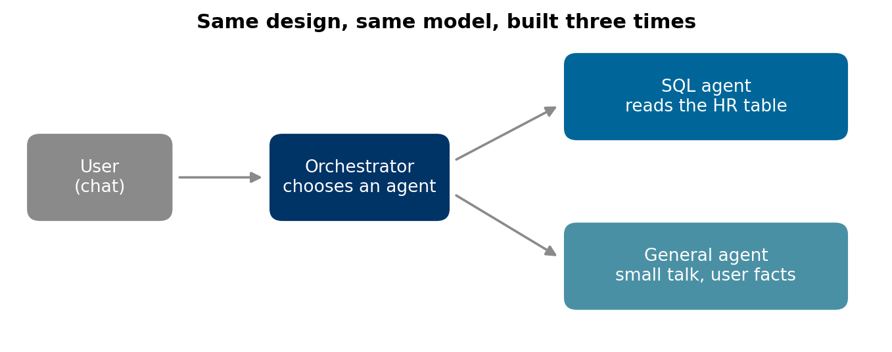
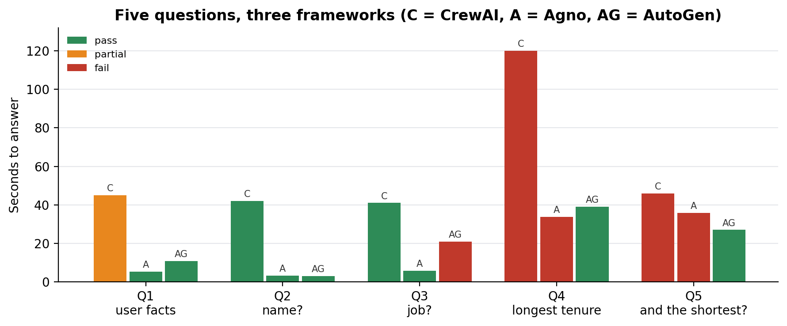

# Agent framework chat test

A five-question test for choosing a multi-agent framework for a chat product, with a synthetic HR table, a grader, and our results for CrewAI, Agno and AutoGen.

Companion code for the article **[CrewAI vs Agno vs AutoGen: which one for a chat product?](https://lucas.rangeltech.net/articles/h6-crewai-vs-agno-vs-autogen/)**.

## The problem

Multi-agent frameworks are usually compared on features. For a chat product, the comparison that matters is whether the conversation holds together, and five questions are enough to see it.

This repository is the protocol we used to compare CrewAI, Agno and AutoGen in one week: the same three-agent design in each (an orchestrator, a SQL agent over an HR table, a general agent), the same model, and the same five messages in order.

> All data in this repository is synthetic, generated by the scripts with a fixed seed, with the shape of a real client problem. No client data, names or code are included.

## What the code does

| # | Message | What it tests |
|---|---|---|
| Q1 | "My name is Ana, I work as an AI analyst..." | storing user facts; small talk |
| Q2 | "What is my name?" | memory |
| Q3 | "What is my job?" | memory, and not routing a personal question to SQL |
| Q4 | "Which employee has been with the company longest?" | routing to SQL without a trigger word |
| Q5 | "And the shortest?" | a follow-up that only means something after Q4 |

Build the design in your candidate framework, send the five messages, save the answers as `{"Q1": "...", ...}` and grade them against `hr.sqlite` with `grade.py`.

## Results

Our run (one per framework, GPT-4o-mini, October 2025) is in `project_results.json`: seconds per answer, outcome and a note for each question. In short, AutoGen was the only one that held the context of Q5 without help; CrewAI needed a trigger word to route to SQL and took about 40 seconds per answer; Agno was the fastest to set up and on small talk but lost the context.





## Run it

Python 3.11 or later.

```bash
pip install -r requirements.txt
python make_db.py
python grade.py my_transcript.json
python figures.py figures
```

## Files

| File | What it is |
|---|---|
| `questions.json` | the five messages and what each tests |
| `make_db.py` | creates the synthetic `hr.sqlite` |
| `grade.py` | grades a transcript against the table |
| `project_results.json` | our measured results |
| `figures.py` | the architecture diagram and seconds per answer |

## License

Apache 2.0. See [LICENSE](LICENSE).
